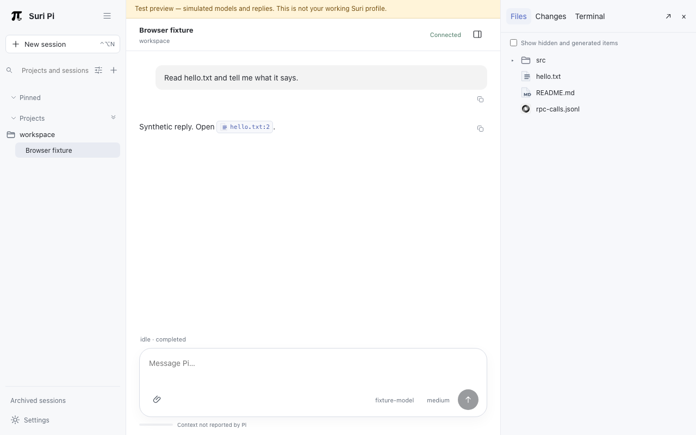
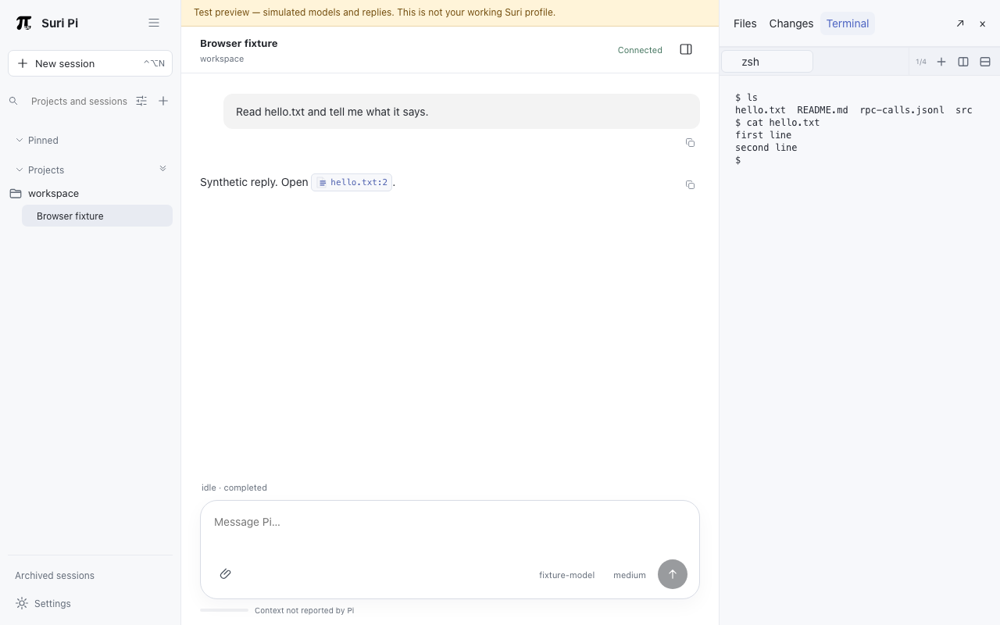

# Suri Pi

Suri Pi is a local web interface for the [Pi coding agent](https://www.npmjs.com/package/@earendil-works/pi-coding-agent)
(`@earendil-works/pi-coding-agent`). It gives Pi a persistent session list, a
transcript with tool output, a composer with queued messages, a workspace file
browser with Git changes and a terminal, instead of a single terminal window.

A Node host on `127.0.0.1` serves a React app and keeps its own SQLite state. The
host starts one Pi process per live session and talks to it over Pi's public
subprocess RPC (JSONL on stdio). Pi stays independently installed and keeps its
own credentials. Suri does not read or store credential files; provider authentication stays in Pi. The one exception is the optional Codex weekly-usage display: it runs Pi's `auth print-bearer-token --provider openai-codex`, keeps the token in memory only and sends it to `chatgpt.com/backend-api/wham/usage`, caching only the sanitized result for a minute. Closing the browser does not stop running
sessions.



## Status

Preview v0.1, built as a portfolio project. Nothing is published to npm.

- **macOS 14+ on Apple silicon** is the supported platform and the only one CI runs on.
- **Linux** is experimental: CI builds and runs the unit, RPC and integration suites on Ubuntu and the synthetic preview runs there, but `npm start` and the CLI `open`/`serve` host require macOS 14+ on Apple silicon, and the browser journeys run only on macOS.
- **Pi versions 0.84.4 and 0.85.1** are the accepted ones; other versions are rejected.
- **Validated:** the test suites in [docs/testing.md](docs/testing.md) pass with a fake Pi and synthetic Pi RPC transcripts. The demo below uses simulated models and replies.
- **Not validated:** a long-running session against a real Pi and a real model provider. That path works by design, but this repository carries no automated proof of it.
- Packaging a native macOS app (`npm run package:macos`) is experimental and not part of CI.

## Getting started

### Prerequisites

| Requirement              | Version                             | How to get it                                                               |
| ------------------------ | ----------------------------------- | --------------------------------------------------------------------------- |
| macOS on Apple silicon   | 14 or newer                         | `sw_vers -productVersion` shows 14 or newer; `uname -m` prints `arm64`      |
| Xcode Command Line Tools | any current                         | `xcode-select --install` (the build compiles a small C helper with `clang`) |
| Node.js                  | **24.15.0 exactly**                 | see below                                                                   |
| npm                      | 11.12.1 (bundled with Node 24.15.0) | comes with Node                                                             |
| Git                      | any                                 | included with the Command Line Tools                                        |

The repository pins Node twice: `.node-version` and `"engines": {"node": "24.15.0"}`,
and `.npmrc` sets `engine-strict=true`, so `npm ci` refuses any other version.
`brew install node@24` installs the newest 24.x, which may not be 24.15.0. Install
the exact version with a version manager:

```sh
brew install fnm
eval "$(fnm env)"
fnm install 24.15.0
fnm use 24.15.0
node -v && npm -v   # v24.15.0 and 11.12.1
```

`nvm install 24.15.0 && nvm use 24.15.0` works the same way, as does the installer
from <https://nodejs.org/dist/v24.15.0/>.

### Quickstart: see the app with synthetic data

No Pi and no API keys are needed. The preview uses a fake Pi that answers with canned replies.

```sh
git clone https://github.com/Surikesh/suri-pi.git && cd suri-pi
npm ci
npm run build
npm run preview:open
```

`npm ci` may print audit warnings; `npm audit --omit=dev` reports no vulnerabilities in
production dependencies, so they concern development-only packages.
`preview:open` starts a synthetic host on a free `127.0.0.1` port and opens it in
your browser. On success you see the Suri interface, connected, with one project (containing `hello.txt`) and a
session named "Browser fixture"; the fake Pi answers with canned replies. Press Ctrl-C in that terminal
to stop it.

To start the preview and open it separately, run `npm run preview` in one terminal and
`npm run preview -- --open` in another. `--open` only opens an already running
preview; it does not start one. The command also prints the URL, which is valid once
and for a short time, in case no browser opens.

The preview keeps its data in a temporary directory (`suri-browser-*` under your
system temp folder), never in your Suri profile. Ctrl-C stops the host but keeps that
directory, so `npm run preview -- --resume` restarts the same catalog and workspace on
the same port. The operating system may clear the temporary directory later, and then
`--resume` no longer works; start a new preview. Rebuilding does not change a running
preview. `npm run preview -- --restart` restarts a running one.

## Use it with Pi

1. **Install a supported Pi** into a directory of your choice. The commands below
   use the lockfile the tests are pinned to; use `0.84.4` instead of `0.85.1` for the older version:

   ```sh
   mkdir -p ~/pi-runtimes/0.85.1
   cp runtime-locks/0.85.1/package*.json ~/pi-runtimes/0.85.1/
   npm ci --ignore-scripts --prefix ~/pi-runtimes/0.85.1
   ~/pi-runtimes/0.85.1/node_modules/.bin/pi --version   # 0.85.1
   ```

   Installing `npm install -g @earendil-works/pi-coding-agent@0.85.1` also gives a `pi`
   command, but Suri probes the package behind the executable and needs the
   dependency closure inside it, so the locked install above is the tested route.

2. **Log in and choose a provider in Pi itself**, following Pi's own documentation.
   Suri does not ask for or store provider credentials, and never writes Pi's global settings.

3. **Start Suri** from the repository after `npm run build`:

   ```sh
   npm start
   ```

   `npm start` starts the host if it is not running (or attaches to the running one) and
   opens the browser. The host survives closing the tab. Check it with
   `node dist/apps/host/src/cli.js status`; stop it with `npm stop`, which refuses while a
   session is working. These commands, like `status`, `doctor` and `catalog`, act on
   your real Suri profile (see the data location below), not on the preview's temporary
   data; set `SURI_DATA_DIR` to point them at another data directory. `npm run browser` is the development variant: it does the same
   and also lets `npm run browser:reload-ui` swap in a rebuilt interface without
   restarting the host.

4. **Register your Pi**, then validate it. A registered runtime is only a candidate; Suri
   promotes it after one real acceptance run, which sends a few prompts to the provider
   and model you name and therefore spends tokens:

   ```sh
   node dist/apps/host/src/cli.js register-runtime ~/pi-runtimes/0.85.1/node_modules/.bin/pi 0.85.1
   node dist/apps/host/src/cli.js validate-runtime <runtime-id> \
     --provider=<provider> --model=<model> --agent-dir=<pi-agent-dir> --confirm-provider-spend
   ```

   `<runtime-id>` is printed by `register-runtime` (`node dist/apps/host/src/cli.js catalog`
   lists it again) and `<pi-agent-dir>` is the directory where Pi keeps its configuration
   and credentials, usually `~/.pi/agent` unless `PI_CODING_AGENT_DIR` is set. Sessions
   use the host's `PI_CODING_AGENT_DIR` (default `~/.pi/agent`), and validation is
   refused with `RUNTIME_VALIDATION_PROFILE_MISMATCH` for any other directory (symlink
   aliases and `~` are resolved), and relative paths are rejected, so start the host
   with the same absolute variable you pass here. Only validated runtimes can run sessions; until then the interface shows
   "This runtime candidate requires real smoke validation."

Data lives in `~/Library/Application Support/Suri Pi` on macOS and
`${XDG_DATA_HOME:-~/.local/share}/suri-pi` on Linux. Set `SURI_DATA_DIR` to use another
location. Deleting that directory resets Suri; it does not touch Pi's own session files.

The registration and validation steps are written from the code, not from a run against a
real provider, so treat them as unverified.

### First session in two minutes

1. Click **+** next to "Projects and sessions" and pick a folder to add it as a project.
2. Click **New session** (Control-Option-N) and choose the Pi runtime and model.
3. Type a prompt in the composer and press Enter. While Pi works, further messages are
   queued as steering or follow-ups; Stop clears the queue.
4. Open the **workspace details** button in the header to browse files, review Git
   changes, and use the terminal in the workspace folder.



## Development

```sh
npm run typecheck
npm run lint            # ESLint, import-boundary, unused-export and docs checks
npm run format:check
npm run build
npm run test:unit
npm run test:rpc
npm run test:integration
npx playwright install chromium webkit   # once
npm run test:e2e
```

Most suites import build output, so run `npm run build` first. What each suite proves
and the flaky-test policy are in [docs/testing.md](docs/testing.md). CI
([.github/workflows/ci.yml](.github/workflows/ci.yml)) runs typecheck, lint,
`format:portable`, build, unit, RPC and integration tests, and a separate job for the
Playwright journeys, on macOS 15 with Node from `.node-version` and npm 11.12.1.

## Architecture

```text
browser (React, Vite)  --HTTP + WebSocket-->  host (Node, SQLite)  --JSONL on stdio-->  Pi (one process per live session)
                                                 |-- files, Git, PTY terminal
```

- `packages/protocol`: runtime schemas, wire types and error codes for the Suri protocol.
- `packages/pi-adapter`: Pi version probe, JSONL framing, command mapping and translation of Pi events into Suri events; also the review-queue Pi extension.
- `packages/model-chain`: see below.
- `apps/host`: the Node host. It supervises Pi processes, persists catalog and session metadata in SQLite, serves the web assets, and provides files, Git and PTY access. It binds `127.0.0.1` only and authenticates the browser with a single-use bootstrap nonce.
- `apps/web`: the React interface (transcript, composer, details panel, file and diff preview, xterm terminal).
- `apps/macos`: an experimental SwiftUI/WKWebView shell that attaches to or starts the host.
- `native/`: a small C helper used by the host.
- `tests/`: unit, integration and Playwright tests, plus synthetic Pi RPC transcripts in `tests/fixtures/pi/`.

Design records: [docs/architecture.md](docs/architecture.md) (protocol, lifecycle, security),
[docs/module-ownership.md](docs/module-ownership.md) (owners and tested invariants),
[docs/adr/](docs/adr/) (decisions).

### `packages/model-chain`

It stays in v0.1 for two reasons. First, it provides the signed file-descriptor broker
framing that the host uses to give a Pi child a private channel back to the host, which the
review-queue Pi extension also relies on. Second, it contains an experimental multi-stage
model-chain runner with a durable journal, exposed to Pi through the project-local extension
[.pi/extensions/model-chain.ts](.pi/extensions/model-chain.ts) (the `model_chain` and
`model_chain_result` tools and the `/model-chain` command). A plan has up to 12 stages,
each with a model, instruction and acceptance checks, and stages are dispatched one at a
time. The runner is experimental: plans accept only the `openai-codex` provider, and the
`herdr` adapter needs the external `herdr` command-line tool. The `suri` adapter runs
stages as Suri sessions through the broker and is only available inside a Suri-started Pi.

## Troubleshooting

**`npm ci` fails with `EBADENGINE`** (`Unsupported engine ... Required: {"node":"24.15.0"}`).
You are on another Node version. Run `node -v` and install 24.15.0 as above.

**`xcode-select: note: no developer tools were found`, or `clang: command not found`.**
Install the Command Line Tools with `xcode-select --install`. On Linux install a C compiler
(the helper is built with `cc`; set `CC` to override).

**`npm run build` fails with `tapi error: malformed file`.** The installed Command Line Tools
SDK is broken (seen with a beta SDK). Point the build at a working one and keep it set for the
tests:

```sh
xcrun --show-sdk-path
ls /Library/Developer/CommandLineTools/SDKs/
export SDKROOT=/Library/Developer/CommandLineTools/SDKs/MacOSX15.sdk   # replace with a name from the ls output
npm run build
```

**`Error: Could not locate the bindings file` or a `NODE_MODULE_VERSION` mismatch** for
`better-sqlite3` or `node-pty`. The native modules were built under another Node version.
Run `npm rebuild better-sqlite3 node-pty` under Node 24.15.0.

**An end-to-end test fails with `EADDRINUSE`.** The fixture server's port is taken. The
`npm run test:e2e` runner picks a free port itself; for other entry points set
`SURI_E2E_PORT=<free port>`.

**Playwright reports `Executable doesn't exist`.** Run `npx playwright install chromium webkit`.

**`RUNTIME_UNSUPPORTED`.** The Pi is not an accepted candidate. The messages are "This Pi
version is not an accepted candidate.", "The runtime package identity is not supported." (not
`@earendil-works/pi-coding-agent`, or its version differs from the one you passed),
"The selected executable is not the declared Pi entrypoint." and "The runtime distribution has
no dependency identity lock." Use 0.84.4 or 0.85.1 installed as described above.

**`RUNTIME_UNAVAILABLE`.** "Pi version check failed (...). No prompt was sent." or "The
runtime dependency closure is unavailable." The executable could not run `--version`, or its
`node_modules` is missing; reinstall Pi. A mismatch is reported as "Pi version mismatch:
expected X, reported Y."

**The browser says the host cannot be reached.** Run `node dist/apps/host/src/cli.js doctor`
to see the preflight result and host state.

## License

MIT, see [LICENSE](LICENSE). Third-party notices, including adapted file-type icon artwork
from DeepSeek Harness (MIT), are in [THIRD_PARTY_NOTICES.md](THIRD_PARTY_NOTICES.md).
